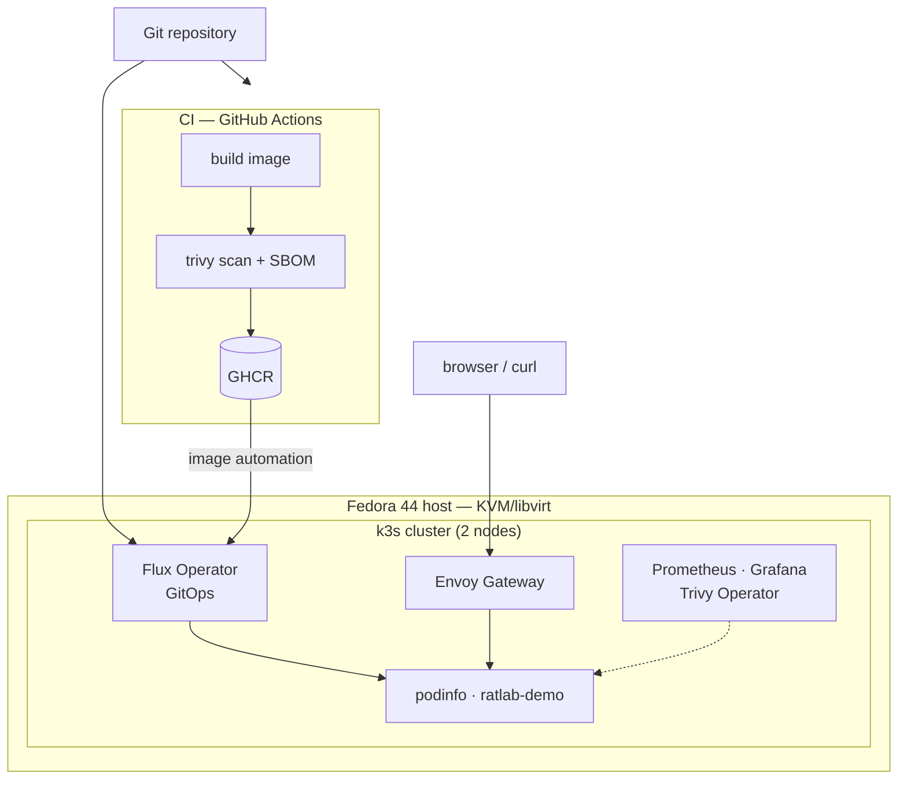

# k8s-homelab-kvm

A two-node Kubernetes homelab that is built and operated entirely as code: from
KVM/libvirt guests on a single Fedora workstation, up through a k3s cluster, a
GitOps reconciliation loop, and a release pipeline that ships images and rolls
them out on its own.

The goal of the project is simple. I wanted somewhere to run real workloads and
learn the infrastructure tooling around them (Kubernetes, GitOps, IaC, CI/CD,
observability, security) without leaning on a cloud account. Everything here is
free and open source, and every decision is written down.

## What it demonstrates

- **Infrastructure as code.** The VMs, the network, and the cluster are all
  reproducible. Shell scripts provision the nodes; the network is described as
  libvirt XML.
- **GitOps.** Flux CD is the only thing allowed to touch the cluster. Deployments,
  controllers, and secrets live in this repository and the cluster converges to
  match it.
- **A real CI/CD loop.** A git tag builds a container image with GitHub Actions,
  pushes it to GHCR, and Flux image automation commits the new tag back into the
  repository and rolls it out. No manual `kubectl` involved.
- **Observability and security.** Prometheus and Grafana for metrics, a Grafana
  dashboard for vulnerability findings, Trivy for image scanning, and Pod Security
  Standards across namespaces.
- **A minimal host.** All operator tooling (kubectl, helm, flux, trivy) runs inside
  a disposable dev container, so the workstation itself stays clean.

## Architecture

The cluster runs on two Ubuntu guests: `k8s-cp-01` (control plane, 3 GiB) and
`k8s-worker-01` (worker, 1536 MiB). Flux reconciles `clusters/k8s-homelab`, which
in turn points at `infrastructure/` (controllers) and `apps/` (workloads). North
south traffic enters through an Envoy Gateway.

## Tech stack

| Layer | Choice |
|---|---|
| Host | Fedora 44 Workstation · KVM/libvirt |
| Cluster | k3s `v1.37.1+k3s1` · containerd `2.3.4-k3s1` · Flannel CNI |
| Toolchain | Devpod workspace on rootless Podman (`quay.io/fedora/fedora:44`) |
| GitOps | Flux CD `v2.9.6`, managed by the Flux Operator (chart `0.61.0`) |
| Secrets | SOPS + age |
| Ingress | Envoy Gateway `v1.9.2` (Gateway API) |
| Observability | kube-prometheus-stack `92.7.0` (Prometheus, Grafana) |
| Security | Trivy `0.75.0` (CLI) · Trivy Operator `0.37.0` · Pod Security Standards |
| CI/CD | GitHub Actions → GHCR, with Flux image automation |

## Repository layout

| Path | What lives there |
|---|---|
| `scripts/` | Preflight and node provisioning (`preflight`, `10-`, `20-`, `30-`, `40-`) |
| `inventory/` | Node addresses, roles, and resources |
| `terraform/` | libvirt network XML (Terraform itself is deferred; see ADR-0005) |
| `clusters/` | Flux app-of-apps entrypoint (`clusters/k8s-homelab/`) |
| `infrastructure/` | Cluster controllers as Git-managed manifests |
| `apps/` | Workloads (podinfo, ratlab-demo) with encrypted secrets |
| `images/` | Application source built by CI (`ratlab-demo`) |
| `config/` | k9s configuration and the gruvbox skin |
| `docs/` | Runbooks, ADRs, system inventory, troubleshooting log |
| `.github/` | CI and lint workflows, templates, Dependabot |

## The lab's endpoints

Once the environment is up, these names resolve to the gateway on the host:

| URL | What |
|---|---|
| `http://flux.local` | Flux Status web UI |
| `http://grafana.local` | Grafana |
| `http://ratlab-demo.local` | The demo application |

## Getting started

Prerequisites: a Fedora host with KVM/libvirt, Podman, and Devpod installed.

1. Bring the environment up in order. The full sequence is in
   [runbook 03](docs/runbooks/03-session-lifecycle.md):
   `kvm on` → `vm start k8s-cp-01` → `vm start k8s-worker-01` →
   `devpod up . --ide none`.
2. Enter the workspace for any cluster work: `devpod ssh k8s-homelab-kvm`.
3. To see how the cluster is reconciled, start with
   [runbook 05](docs/runbooks/05-gitops-flux.md).

New here? Read the [documentation index](docs/README.md), then
[`docs/system-inventory.md`](docs/system-inventory.md) for exactly what exists
right now.

## Documentation

- [Documentation index](docs/README.md)
- [Runbooks](docs/runbooks) — 01 through 09, in order
- [Architecture decision records](docs/adr) — the *why* behind each choice
- [System inventory](docs/system-inventory.md) — verified host, cluster, workspace state
- [Roadmap](docs/roadmap.md) — phase plan and what is deferred
- [Troubleshooting log](docs/troubleshooting-log.md) — every real failure, documented

## License

Released under the [MIT License](LICENSE).
